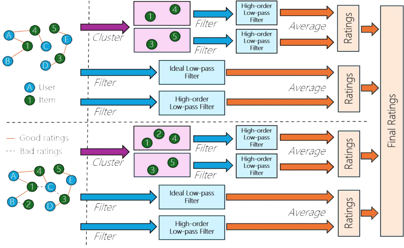
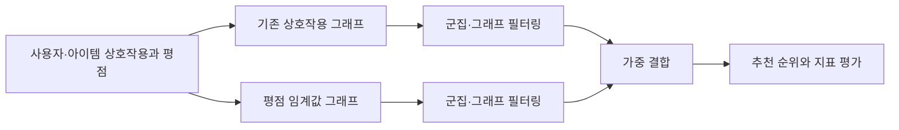

<div align="center">

# 사용자 평점 기반 그래프 추천

**Rating-Aware-Recommendation-Project**

**기술 분류:** 추천 시스템 › 그래프 신호 처리 › 평점 반영 이중 그래프 필터

### 사용자 평점 기반 그래프 필터링 추천
### Performance Improvement of Recommendation Systems using User Evaluation Information

**Rating-Aware Graph Filtering · HiGSP · MovieLens · CiaoDVD**

사용자와 아이템의 상호작용 여부에 평점 정보를 추가하여 추천 순위를 개선하는 공동 연구 원고입니다. 기존 상호작용 그래프와 평점 임계값으로 구성한 그래프를 각각 처리하고 결과를 가중 결합합니다.<br>

 

[원고 읽기](#quick-start) · [저장소 구성](#structure) · [자료·설정](#data)

[예시 이미지](#preview)

</div>

<a name="preview"></a>

## 🖼️ 예시로 보기

<p align="center"></p>

**논문 그림** — 공개 원고 4쪽 그림 1: 평점 정보를 반영하는 제안 모델의 구조입니다.

[근거 파일 보기](%EB%85%BC%EB%AC%B8/%EC%B5%9C%EC%A2%85_%EB%85%BC%EB%AC%B8.pdf)


<a name="input-processing-output"></a>

## 🔄 입력·처리·출력

| 단계 | 이 프로젝트에서 다루는 내용 |
| :--- | :--- |
| 입력 | 사용자·아이템 상호작용과 평점 |
| 처리 | HiGSP 기반 두 그래프·필터 점수 결합 |
| 출력 | 추천 순위와 NDCG·MRR 지표 |


---

## ✨ 프로젝트 소개

저자: **김희찬 · 곽윤석 · 김남기**

한국사물인터넷학회 논문지 양식의 원고입니다. 권·호 자리표시자가 남아 있어 게재 완료를 뜻하지 않습니다.

| 항목 | 원고에서 다루는 내용 |
|---|---|
| 두 그래프 구성 | 전체 상호작용 그래프와 평점 2 또는 5 이상 그래프를 구분합니다. |
| 그래프 필터링 | 사용자 군집과 이상·고차 저역통과 필터를 적용합니다. |
| 가중 결합 | 기존 HiGSP 경로와 평점 기반 경로의 예측을 결합합니다. |
| 추천 지표 비교 | 네 데이터셋의 F1·MRR·NDCG를 K=5·10에서 비교합니다. |



<a name="structure"></a>
## 📁 저장소 구성

```text
.
├── README.md
├── CHANGELOG.md
└── 논문/
    └── 최종_논문.pdf
```

- [전체 최종 원고](논문/최종_논문.pdf)

## 🧩 평점 정보와 가중 결합

ML-100K, ML-Latest-Small, ML-1M, CiaoDVD를 사용한 비교를 설명합니다. 기본 결합 비율은 5:5이며 Ratings5의 ML-Latest-Small은 7:3, ML-1M은 8:2의 예외를 둡니다. 따라서 두 설정의 차이를 평점 임계값 하나의 효과로 해석하지 않습니다.

원고는 alpha1 0.3, alpha2 0.7, 필터 차수 8, 특이성분 수 256, 군집 수 5, random_state 2024를 기술합니다. 환경표와 패키지 버전은 당시 원고의 기록이며 현재 환경에서 실행 확인한 설정이 아닙니다.

<a name="quick-start"></a>
## 🚀 원고 읽기

1. 위의 최종 원고 링크를 엽니다.
2. 서론의 연구 질문과 방법을 먼저 읽습니다.
3. 결과표와 함께 한계·후속 연구를 확인합니다.

이 저장소는 논문 열람을 위한 구성이므로 패키지 설치나 모델 실행 명령을 제시하지 않습니다. 원본 프로젝트 폴더에서 지정한 코드 확장자의 일반 파일을 검색했으며, 압축 파일 내부 코드는 검사하지 않았습니다. 확인하지 않은 구현의 존재 여부는 단정하지 않습니다.

<a name="data"></a>
## 📊 자료 구성과 결과 해석

연구 원고 한 개를 보존합니다. 추천서비스의 실제 사용자 기록이나 데이터셋 원본은 업로드하지 않습니다. 공개 사본에서는 저자 소개의 개인 얼굴 사진을 제외하고 저자명·연구 본문·도표는 보존하는 구성을 사용합니다.

### 원고가 보고한 결과와 한계

원고의 Ratings2는 24개 데이터셋·지표 조합 중 23개에서 향상을 보고하며, ML-1M MRR@10은 0.5603에서 0.5601로 감소합니다. Ratings5는 24개 모두 향상했다고 보고합니다. CiaoDVD MRR@5의 상대 향상 16.54%는 절대값 0.0133→0.0155의 차이와 함께 해석해야 합니다.

실행시간·메모리를 측정하지 않아 계산 효율 향상은 확인되지 않았습니다. 추가 그래프 처리 비용, 가중치 차이와 통계적 유의성의 한계를 구분합니다.

## 🛠 문제 해결

| 상황 | 확인할 내용 |
|---|---|
| 추천 결과를 바로 재현하고 싶습니다. | 이 문서는 논문 중심 자료입니다. 실행 가능한 코드·환경 파일의 포함을 보장하지 않습니다. |
| 모든 지표가 개선되었나요? | Ratings2의 ML-1M MRR@10 감소를 포함하여 조건별 결과를 확인하세요. |
| 상대 개선율이 크게 보입니다. | 낮은 기준 점수에서는 상대율이 커질 수 있으므로 절대 점수 차이도 함께 보세요. |

<div align="center">

연구 질문과 확인된 범위를 함께 읽는 논문 기록입니다.

</div>
