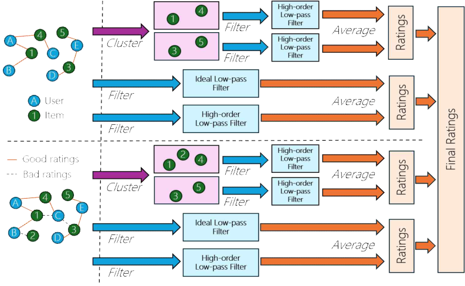
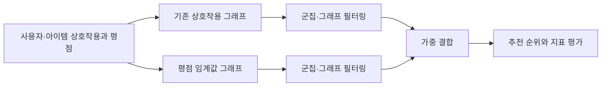

# Rating-Aware-Recommendation-Project — LEVEL 4 - Advanced

**읽기 수준 선택** · [LEVEL 1 - Beginner](%EB%A0%88%EB%B2%A81.md) · [LEVEL 2 - Explorer](%EB%A0%88%EB%B2%A82.md) · [LEVEL 3 - Practitioner](%EB%A0%88%EB%B2%A83.md) · **LEVEL 4 - Advanced** · [LEVEL 5 - Expert](%EB%A0%88%EB%B2%A85.md)

[같은 수준 프로필](https://github.com/PUVKID/PUVKID/blob/main/docs/읽기안내/레벨4.md) · [저장소 첫 화면](../../README.md)

**논문 읽기:** 김희찬·곽윤석·김남기의 논문은 사물인터넷융복합논문지 12(5), 25–33쪽, 2026.10에 게재되었습니다. 전체 9쪽 게재본은 [공식 KCI 페이지](https://www.kci.go.kr/kciportal/landing/article.kci?arti_id=ART003399306)에서 읽을 수 있습니다. 표지의 DOI는 10.20465/KIOTS.2026.12.5.025이며 온라인 읽기는 KCI로 안내합니다. **HWP는 기존 투고 원고**입니다. 게재본 PDF는 저장소에 첨부하지 않습니다. 과거 차수의 파일 구성도·해시·쪽수는 해당 투고 자료의 이력으로 읽어 주세요.

<a id="guide-intro"></a>

## 프로젝트 소개

상호작용을 모두 버리지 않으면서 평점 기반 선택 정보를 추가하는 이중 그래프 설계입니다. 임계값·결합 가중치와 데이터셋이 동시에 비교 조건에 들어갑니다. 평점 활용 자체의 효과를 단일 설정의 개선으로 일반화하지 않습니다.

<a id="guide-problem"></a>

## 문제와 주요 기능

평점 임계값은 추가 그래프의 인접행렬을 구성하는 기준입니다. 기존 그래프는 낮은 평점 관계를 제거할 때 생길 정보 손실을 줄이는 통로입니다. 두 필터 출력의 가중 결합은 정보 선택과 보존의 트레이드오프입니다.

<a id="guide-flow"></a>

## 입력·처리·출력

두 인접행렬에 독립 필터를 적용한 뒤 출력을 결합합니다. 결과표의 차이는 그래프 구성과 결합 가중치의 결합 효과일 수 있습니다. 모델식·데이터 분할·평가 cutoff가 같다는 근거를 원고에서 확인합니다.

<a id="guide-practice"></a>

## 실험과 사용 흐름

재현 설계에서는 관측 상호작용과 평점 전처리, 분할, 필터·가중치, cutoff를 고정해야 합니다. 현재 공개 자료로 실행 계보를 전부 검증할 수는 없습니다. 보고표의 열화·작은 차이도 함께 유지합니다.

<a id="guide-results"></a>

## 관측 결과와 해석

Ratings2의ML-1M 열화와 작은 개선을 유지합니다. CiaoDVD는K5에서Ratings5가, K10에서는Ratings2가 더 나은 지표가 있어 임계값 하나가 일관되게 우월하지 않습니다. 가중치 예외도 해석에 포함합니다.

<a id="guide-architecture"></a>

## 구현과 핵심 파일

구조 검토는 인접행렬 정의와 필터·가중 결합에 집중합니다. 실행 구현의 메모리·지연·학습 로그는 제공된 측정이 없으면 평가하지 않습니다. 문서 편집과 모델 구현 변경은 다른 작업입니다.

<a id="guide-paper"></a>

## 실제 논문과 원고

공식 KCI 서지와 게재본 표지를 대조했습니다. KCI DOI필드가 비어 있고 인쇄 DOI의 온라인 해결이 확인되지 않았으므로 이를 정상 DOI 링크처럼 안내하지 않습니다. 투고 원고의 날짜·판본 설명은 당시 맥락으로 유지합니다.

<a id="guide-limits"></a>

## 조건·실패·미검증 한계

평점 희소화와 기존 정보 보존의 균형은 데이터에 의존합니다. 서로 다른 가중치로 얻은 결과를 임계값 하나의 효과로 설명하지 않습니다. 미공개 분할·실행 정보가 일반화와 독립 재현을 제한합니다.

## 전체 차수

차수는 아래의 실제 자료 구분을 따릅니다. 설명은 현재 선택한 수준으로 열리며, 자료 폴더와 당시 전체 비교도 함께 확인할 수 있습니다.

| 차수·단계 · 같은 수준 설명 · 자료 폴더 · 직전 비교·구성 |
| --- |
| **차수·단계**<br>1차 · 06.17/06.22/06.29 원고 묶음<br><br>**같은 수준 설명**<br>[LEVEL 4 - Advanced](../revisions/paper-1.md#reading-level-4)<br><br>**자료 폴더**<br>[자료](../../%EC%9B%90%EA%B3%A0%EB%8B%A8%EA%B3%84/1%EC%B0%A8)<br><br>**직전 비교·구성**<br>[전체 비교](../revision-diffs/paper-1.diff) |
| **차수·단계**<br>2차 원고<br><br>**같은 수준 설명**<br>[LEVEL 4 - Advanced](../revisions/paper-2.md#reading-level-4)<br><br>**자료 폴더**<br>[자료](../../%EB%85%BC%EB%AC%B8)<br><br>**직전 비교·구성**<br>[전체 비교](../revision-diffs/paper-2.diff) |
| **차수·단계**<br>3차 · 사물인터넷학회 양식 원고<br><br>**같은 수준 설명**<br>[LEVEL 4 - Advanced](../revisions/paper-3.md#reading-level-4)<br><br>**자료 폴더**<br>[자료](../../%EB%85%BC%EB%AC%B8)<br><br>**직전 비교·구성**<br>[전체 비교](../revision-diffs/paper-3.diff) |
| **차수·단계**<br>최종 원고<br><br>**같은 수준 설명**<br>[LEVEL 4 - Advanced](../revisions/final.md#reading-level-4)<br><br>**자료 폴더**<br>[자료](../../%EB%85%BC%EB%AC%B8)<br><br>**직전 비교·구성**<br>[전체 비교](../revision-diffs/final.diff) |

## 첫 화면의 모든 설명과 공통 근거

아래는 기존 첫 화면의 실질 구성 전체입니다. 각 항목의 개념은 이 페이지의 풀이와 연결하고, 실제 표·코드·그림·상세 조건은 원문 공통 근거에서 확인합니다. 기존 전체 비교는 문장·주석·파일 단위의 작은 변화까지 보존하는 자료입니다.

| 첫 화면 구성 · 이 수준의 풀이 · 원문 공통 근거 |
| --- |
| **첫 화면 구성**<br>연구 요약<br><br>**이 수준의 풀이**<br>[프로젝트 소개](#guide-intro)<br><br>**원문 공통 근거**<br>[전체 설명·표·그림](../../README.md#-%EC%97%B0%EA%B5%AC-%ED%95%B5%EC%8B%AC) |
| **첫 화면 구성**<br>입력·처리·출력<br><br>**이 수준의 풀이**<br>[입력·처리·출력](#guide-flow)<br><br>**원문 공통 근거**<br>[전체 설명·표·그림](../../README.md#-%EC%9E%85%EB%A0%A5%EC%B2%98%EB%A6%AC%EC%B6%9C%EB%A0%A5) |
| **첫 화면 구성**<br>논문과 최신 자료<br><br>**이 수준의 풀이**<br>[실제 논문과 원고](#guide-paper)<br><br>**원문 공통 근거**<br>[전체 설명·표·그림](../../README.md#-%EB%85%BC%EB%AC%B8%EA%B3%BC-%EC%B5%9C%EC%8B%A0-%EC%9E%90%EB%A3%8C) |
| **첫 화면 구성**<br>전체 차수<br><br>**이 수준의 풀이**<br>[문제와 주요 기능](#guide-problem)<br><br>**원문 공통 근거**<br>[전체 설명·표·그림](../../README.md#%EF%B8%8F-%EC%B0%A8%EC%88%98%EB%B3%84-%ED%94%84%EB%A1%9C%EC%A0%9D%ED%8A%B8-%EC%95%88%EB%82%B4) |
| **첫 화면 구성**<br>연구 방법<br><br>**이 수준의 풀이**<br>[프로젝트 소개](#guide-intro)<br><br>**원문 공통 근거**<br>[전체 설명·표·그림](../../README.md#-%ED%94%84%EB%A1%9C%EC%A0%9D%ED%8A%B8-%EC%86%8C%EA%B0%9C) |
| **첫 화면 구성**<br>저장소 구성<br><br>**이 수준의 풀이**<br>[구현과 핵심 파일](#guide-architecture)<br><br>**원문 공통 근거**<br>[전체 설명·표·그림](../../README.md#-%EC%A0%80%EC%9E%A5%EC%86%8C-%EA%B5%AC%EC%84%B1) |
| **첫 화면 구성**<br>평점 정보와 가중 결합<br><br>**이 수준의 풀이**<br>[프로젝트 소개](#guide-intro)<br><br>**원문 공통 근거**<br>[전체 설명·표·그림](../../README.md#-%ED%8F%89%EC%A0%90-%EC%A0%95%EB%B3%B4%EC%99%80-%EA%B0%80%EC%A4%91-%EA%B2%B0%ED%95%A9) |
| **첫 화면 구성**<br>원고 읽기<br><br>**이 수준의 풀이**<br>[실제 논문과 원고](#guide-paper)<br><br>**원문 공통 근거**<br>[전체 설명·표·그림](../../README.md#-%EC%9B%90%EA%B3%A0-%EC%9D%BD%EA%B8%B0) |
| **첫 화면 구성**<br>자료 구성과 결과 해석<br><br>**이 수준의 풀이**<br>[관측 결과와 해석](#guide-results)<br><br>**원문 공통 근거**<br>[전체 설명·표·그림](../../README.md#-%EC%9E%90%EB%A3%8C-%EA%B5%AC%EC%84%B1%EA%B3%BC-%EA%B2%B0%EA%B3%BC-%ED%95%B4%EC%84%9D) |
| **첫 화면 구성**<br>문제 해결<br><br>**이 수준의 풀이**<br>[조건·실패·미검증 한계](#guide-limits)<br><br>**원문 공통 근거**<br>[전체 설명·표·그림](../../README.md#-%EB%AC%B8%EC%A0%9C-%ED%95%B4%EA%B2%B0) |
| **첫 화면 구성**<br>최신 문서와 변경 이력<br><br>**이 수준의 풀이**<br>[실제 논문과 원고](#guide-paper)<br><br>**원문 공통 근거**<br>[전체 설명·표·그림](../../README.md#-%ED%98%84%EC%9E%AC-%EC%B2%A8%EB%B6%80-%EB%AC%B8%EC%84%9C) |
| **첫 화면 구성**<br>차수별 방법과 조건<br><br>**이 수준의 풀이**<br>[문제와 주요 기능](#guide-problem)<br><br>**원문 공통 근거**<br>[전체 설명·표·그림](../../README.md#-%EC%97%B0%EA%B5%AC%EA%B5%AC%ED%98%84%EC%9D%98-%EC%84%B8%EB%B6%80-%ED%9D%90%EB%A6%84) |

## 이어 읽기

같은 난이도로 다른 프로젝트를 찾으려면 [프로필의 LEVEL 4 - Advanced](https://github.com/PUVKID/PUVKID/blob/main/docs/읽기안내/레벨4.md)를 엽니다. 이 저장소 안에서는 위 전체 차수 표의 같은 수준 설명으로 이동하세요. 단계별 선택표에서 깊이를 바꿀 수 있으며, LEVEL 5 아래에는 기존 상세 전체가 보존되어 있습니다.

## LEVEL 4 · 조건과 결과를 자세히 읽기

아래 조건은 원고·공개 노트북에 있는 값입니다. 차수별 상세는 각 단계의 기록이며, 최신 원고의 설정을 이전 차수에서 새로 얻은 결과로 소급하지 않습니다.

### LEVEL 4 · 두 그래프의 역할

**실제 조건:** 전체 사용자·아이템 상호작용 그래프 + 평점 임계값 그래프. Ratings2는 2 이상, Ratings5는 5 이상. 군집·그래프 필터링 뒤 두 경로 점수를 결합합니다.

평점 필터링에 따른 연결 희소화와 전체 상호작용의 정보 보존을 함께 검토합니다. 임계값 변화는 그래프 구조를 바꾸며, 최종 가중 결합의 영향과 혼동하면 어떤 변경이 성능에 기여했는지 분리할 수 없습니다.

### LEVEL 4 · 네 데이터셋의 규모

**실제 조건:** 원고 표기: ML-100K 943명/1,682아이템/100K/1~5점; ML-Latest-Small 610명/9,724/100K/0.5~5.0점; ML-1M 6,040명/3,706/1M/1~5점; CiaoDVD 17,615명/16,121/72K/1~5점.

서로 다른 규모와 평점 척도에서 같은 임계값을 적용하면 남는 연결의 비율이 달라집니다. 규모 표는 비교 맥락이고 사용자 로그의 품질·시간 순서·중복·분할 독립성을 증명하지 않으므로 별도 검증 항목으로 둡니다.

### LEVEL 4 · 결합 비율과 필터 설정

**실제 조건:** HiGSP:평점 경로 기본 5:5. Ratings5의 ML-Latest-Small 7:3, ML-1M 8:2. alpha1=0.3·alpha2=0.7·차수8·특이성분256·군집5·random_state2024.

이중 경로의 가중치와 각 필터의 내부 계수를 별도 실험 축으로 다룹니다. 특이성분·군집 수·차수가 계산 비용과 표현에 미치는 영향도 검토해야 하며, seed가 같다고 모든 환경에서 결정론적 실행을 보장하지 않습니다.

### LEVEL 4 · 추천 지표와 목록 길이

**실제 조건:** K=5·10, F1·MRR·NDCG. 네 데이터셋 × 두 K × 세 지표 = 24조합.

F1은 정밀도·재현율의 균형, MRR은 상위 정답 위치, NDCG는 할인된 관련도의 정규화라는 목적 차이를 유지합니다. 원고만으로 알 수 없는 정답 구성·후보군·집계 세부를 임의의 표준 구현으로 채우지 않습니다.

### LEVEL 4 · 개선 수와 감소한 조건

**실제 조건:** Ratings2 23/24 향상, ML-1M MRR@10 0.5603→0.5601 감소. Ratings5 24/24 향상. 모두 원고 보고 결과입니다.

23/24라는 승패 집계는 효과 크기·분산·계산 비용을 누락할 수 있습니다. 감소 예외와 가중치 예외를 동시에 검토해야 특정 하이퍼파라미터의 우수성으로 결론을 과도하게 좁히지 않습니다.

### LEVEL 4 · 절대 점수·상대 향상과 K별 역전

**실제 조건:** CiaoDVD MRR@5 0.0133→0.0155, 절대 차이0.0022·원고 보고 상대 향상률16.54%. K5의 세 지표는 Ratings5가 더 높고, K10은 Ratings2가 더 높습니다.

CiaoDVD의 역전은 단일 임계값을 모든 추천 길이에 고정하는 결론을 지지하지 않습니다. 상대 향상률의 분모, 표의 저장 정밀도, 결합 비율 변화와 후보 목록 구성을 함께 검토해야 합니다.

### LEVEL 4 · 자료 범위와 논문 읽기

**실제 조건:** 한국사물인터넷학회, 사물인터넷융복합논문지12(5),25–33쪽,2026.10,김희찬·곽윤석·김남기. 공식 KCI 링크. 기존 HWP는 투고본; 공개 실행 코드·분할 목록·실제 사용자 로그는 제공하지 않습니다.

원고의 환경표는 구현과 실행 증거를 대체하지 않습니다. 처리 시간·메모리·추가 그래프 비용·통계적 유의성·가중치 영향의 미평가 범위를 유지합니다. 서지 수정 차수를 독립 성능 실험으로 누적하지 않습니다.

<!-- complete-source-facts17:start -->

## 첫 화면의 세부 사실을 빠짐없이 읽기

위의 수준별 풀이에 대응하는 실제 세부 사실입니다. 입력·조건·수치·표·그림·문서 판본과 작은 변경까지 같은 페이지에서 확인하도록 기존 첫 화면의 내용을 함께 수록했습니다. 각 절은 해당 수준의 앞선 설명과 연결해 읽으며, 원래 실행 코드·전체 비교·원고는 원문 주소로 이어집니다.

<a id="facts-section-0"></a>

### LEVEL 4 · 첫 화면 기본 정보


사용자 평점을 반영한 그래프 필터로 추천 순위를 만드는 연구입니다.

분야: 추천 시스템 › 그래프 신호 처리 › 평점 반영 이중 그래프 필터

`논문·연구 자료` `Document`

[원고 읽기](../../README.md#quick-start) · [저장소 구성](../../README.md#structure) · [자료·설정](../../README.md#data)

[핵심 구성](../../README.md#input-processing-output)

<details>
<summary>원고 제목</summary>

Performance Improvement of Recommendation Systems using User Evaluation Information

</details>


<a id="facts-section-1"></a>

### LEVEL 4 · 연구 요약


상호작용 그래프와 평점 정보를 결합하여 추천 순위를 평가하는 원고입니다.

추천 그래프의 구성과 데이터셋별 비교 결과를 원고에 정리했습니다.

- 두 그래프를 결합하는 설계와 네 데이터셋의 평점·상호작용 구성을 설명합니다.
- K별 F1·NDCG·MRR을 비교하며, ML-1M에서는 MRR@10이 감소한 결과도 함께 보고합니다.

**자료별 안내:** [최종 원고](../../docs/versions/final-paper.md) · [전체 기록](../../docs/VERSIONS.md)




**논문 그림** — 공개 원고 4쪽 그림 1: 평점 정보를 반영하는 제안 모델의 구조입니다.

[근거 파일 보기](https://www.kci.go.kr/kciportal/landing/article.kci?arti_id=ART003399306)


<a id="facts-section-2"></a>

### LEVEL 4 · 입력·처리·출력


**구분**

문제

**내용**

평점 정보를 추가한 그래프가 추천 순위에 미치는 영향을 비교합니다.


**구분**

입력

**내용**

사용자·아이템 상호작용과 평점


**구분**

처리

**내용**

HiGSP 기반 두 그래프·필터 점수 결합


**구분**

출력

**내용**

추천 순위와 NDCG·MRR 지표


---


<a id="facts-section-3"></a>

### LEVEL 4 · 논문과 최신 자료


| 자료 · 원문 파일 |
| --- |
| **자료**<br>최종 논문 · 평점 기반 추천<br><br>**원문 파일**<br>[공식 게재 페이지](https://www.kci.go.kr/kciportal/landing/article.kci?arti_id=ART003399306) |
| **자료**<br>최종 논문 · 평점 기반 추천<br><br>**원문 파일**<br>[HWP 다운로드](../../%EB%85%BC%EB%AC%B8/%EC%B5%9C%EC%A2%85_%EC%9B%90%EB%AC%B8_%EB%85%BC%EB%AC%B8.hwp) |

[자료별 설명](../../docs/PAPERS.md) · [코드 차수와 변경 이력](../../docs/REVISION_INDEX.md)


<a id="facts-section-4"></a>

### LEVEL 4 · 전체 차수


| 차수·단계 · 주요 내용 · 자료 · 직전 비교 |
| --- |
| **차수·단계**<br>[1차 · 06.17/06.22/06.29 원고 묶음](../../docs/revisions/paper-1.md#reading-level-4)<br><br>**주요 내용**<br>06.17·06.22·06.29의 수정본과 영문 원고가 이어진 초기 편집 단계입니다.<br><br>**자료**<br>[폴더](../../%EC%9B%90%EA%B3%A0%EB%8B%A8%EA%B3%84/1%EC%B0%A8)<br><br>**직전 비교**<br>[전체 비교](../../docs/revision-diffs/paper-1.diff) |
| **차수·단계**<br>[2차 원고](../../docs/revisions/paper-2.md#reading-level-4)<br><br>**주요 내용**<br>[상세 설명](#layout18-table-5-row-2-field-1)<br><br>**자료**<br>[폴더](../../%EB%85%BC%EB%AC%B8)<br><br>**직전 비교**<br>[전체 비교](../../docs/revision-diffs/paper-2.diff) |
| **차수·단계**<br>[3차 · 사물인터넷학회 양식 원고](../../docs/revisions/paper-3.md#reading-level-4)<br><br>**주요 내용**<br>국영문 초록·제목·양식을 정리한 편집 단계이며, 같은 연구의 여러 참고문헌 판을 구분해 읽습니다.<br><br>**자료**<br>[폴더](../../%EB%85%BC%EB%AC%B8)<br><br>**직전 비교**<br>[전체 비교](../../docs/revision-diffs/paper-3.diff) |
| **차수·단계**<br>[최종 원고](../../docs/revisions/final.md#reading-level-4)<br><br>**주요 내용**<br>[상세 설명](#layout18-table-5-row-4-field-1)<br><br>**자료**<br>[폴더](../../%EB%85%BC%EB%AC%B8)<br><br>**직전 비교**<br>[전체 비교](../../docs/revision-diffs/final.diff) |

<a id="layout18-table-5-row-2-field-1"></a>

**[2차 원고](../../docs/revisions/paper-2.md#reading-level-4)**

**주요 내용**

평가 대상을 네 데이터셋으로 정리하고 평점 임계값·결합 비율과 지표의 예외를 명확히 한 원고 단계입니다.

<a id="layout18-table-5-row-4-field-1"></a>

**[최종 원고](../../docs/revisions/final.md#reading-level-4)**

**주요 내용**

사용자 평점 정보를 기존 상호작용 그래프와 결합해 추천 순위의 성능을 비교한 당시 10쪽 투고 원고를 설명하는 단계입니다. 현재 9쪽 게재본은 공식 KCI 페이지에서 확인합니다.


<a id="facts-section-5"></a>

### LEVEL 4 · 연구 방법


저자: **김희찬 · 곽윤석 · 김남기**

한국사물인터넷학회의 **사물인터넷융복합논문지** 양식으로 작성한 연구 원고입니다.

**항목**

두 그래프 구성

**원고에서 다루는 내용**

전체 상호작용 그래프와 평점 2 또는 5 이상 그래프를 구분합니다.


**항목**

그래프 필터링

**원고에서 다루는 내용**

사용자 군집과 이상·고차 저역통과 필터를 적용합니다.


**항목**

가중 결합

**원고에서 다루는 내용**

기존 HiGSP 경로와 평점 기반 경로의 예측을 결합합니다.


**항목**

추천 지표 비교

**원고에서 다루는 내용**

네 데이터셋의 F1·MRR·NDCG를 K=5·10에서 비교합니다.





<a id="facts-section-6"></a>

### LEVEL 4 · 저장소 구성


```text
.
├── README.md
├── CHANGELOG.md
└── 논문/
    └── 최종_논문.pdf
```

- [전체 최종 원고](https://www.kci.go.kr/kciportal/landing/article.kci?arti_id=ART003399306)


<a id="facts-section-7"></a>

### LEVEL 4 · 평점 정보와 가중 결합


ML-100K, ML-Latest-Small, ML-1M, CiaoDVD를 사용한 비교를 설명합니다. 평점 임계값은 추가 그래프에 남길 상호작용을 고르는 기준입니다. 기존 그래프를 함께 사용하는 이유는 낮은 평점의 상호작용까지 모두 버리면서 생길 수 있는 정보 손실을 줄이기 위해서입니다.

기본 결합 비율은 5:5이며 Ratings5의 ML-Latest-Small은 7:3, ML-1M은 8:2의 예외를 둡니다. 두 설정의 비교에는 평점 임계값과 그래프 결합 비율의 영향이 함께 반영됩니다.

실험 설정은 alpha1 0.3, alpha2 0.7, 필터 차수 8, 특이성분 수 256, 군집 수 5, random_state 2024입니다. 당시의 환경과 패키지 버전은 원고의 환경표에 정리했습니다.


<a id="facts-section-8"></a>

### LEVEL 4 · 원고 읽기


1. 위의 최종 원고 링크를 엽니다.
2. 서론의 연구 질문과 방법을 먼저 읽습니다.
3. 결과표와 함께 한계·후속 연구를 확인합니다.

사용자 평점과 상호작용 그래프를 결합한 추천 방법과 데이터셋별 비교 결과를 담은 연구 논문을 수록했습니다.


<a id="facts-section-9"></a>

### LEVEL 4 · 자료 구성과 결과 해석


현재 게재본은 공식 KCI 페이지로 안내하고 기존 편집 원본은 투고 원고로 보존합니다. 1~3차의 수정 내용은 변경 설명과 비교 이력에 남겼습니다.

추천서비스의 실제 사용자 기록이나 데이터셋 원본은 업로드하지 않습니다. 현재 최종 원문은 저자명·공식 소속·이메일·저자소개 사진과 연구 본문·도표를 보존하며 이전 공개본은 Git 변경 이력에서 확인할 수 있습니다.


#### LEVEL 4 · 원고가 보고한 결과와 한계

원고의 Ratings2는 24개 데이터셋·지표 조합 중 23개에서 향상을 보고하며, ML-1M MRR@10은 0.5603에서 0.5601로 감소합니다. Ratings5는 24개 모두 향상했다고 보고합니다.

CiaoDVD MRR@5는 0.0133→0.0155로 증가했으며 상대 향상률은 16.54%입니다.

CiaoDVD에서는 K=5의 세 지표 모두 Ratings5가 Ratings2보다 높지만, K=10에서는 Ratings2가 더 높습니다. 적합한 임계값은 데이터셋과 평가 K에 따라 달라집니다.

**데이터셋**

ML-100K

**사용자**

943

**아이템**

1,682

**상호작용 수**

100K

**평점 범위**

1~5


**데이터셋**

ML-Latest-Small

**사용자**

610

**아이템**

9,724

**상호작용 수**

100K

**평점 범위**

0.5~5.0


**데이터셋**

ML-1M

**사용자**

6,040

**아이템**

3,706

**상호작용 수**

1M

**평점 범위**

1~5


**데이터셋**

CiaoDVD

**사용자**

17,615

**아이템**

16,121

**상호작용 수**

72K

**평점 범위**

1~5


위 규모는 원고 5쪽 표의 표기입니다. 원고는 ML-100K·ML-1M의 학습·시험 자료를 새로 분할했다고 설명하지만, 공개 실행 코드나 분할 목록은 제공하지 않습니다.

F1은 추천 목록의 정밀도·재현율을 함께, MRR은 정답의 순위를, NDCG는 순위에 따른 관련도를 비교하는 지표입니다. 결과는 모두 K=5·10으로 나누어 읽어 주세요.

실행시간·메모리 측정, 추가 그래프의 처리 비용과 통계적 유의성 검증은 후속 과제입니다. 그래프 가중치의 영향도 함께 평가할 필요가 있습니다.


<a id="facts-section-10"></a>

### LEVEL 4 · 문제 해결


**상황**

추천 결과를 바로 재현하고 싶습니다.

**확인할 내용**

논문 중심 자료입니다. 실행 가능한 코드·환경 파일의 포함을 보장하지 않습니다.


**상황**

모든 지표가 개선되었나요?

**확인할 내용**

Ratings2의 ML-1M MRR@10 감소를 포함하여 조건별 결과를 확인하세요.


**상황**

상대 개선율이 크게 보입니다.

**확인할 내용**

낮은 기준 점수에서는 상대율이 커질 수 있으므로 절대 점수 차이도 함께 보세요.


현재 최종 원고는 [공식 게재 페이지](https://www.kci.go.kr/kciportal/landing/article.kci?arti_id=ART003399306)입니다. 이전 초안은 해당 차수의 자료로 구분합니다.


<a id="facts-section-11"></a>

### LEVEL 4 · 최신 문서와 변경 이력


현재 제공하는 원문과 직전 공개본의 비교입니다. 이전 원고·발표와 코드는 전체 차수 표에서 확인할 수 있습니다.

| 문서 · 자료 폴더 · 상세 · 직전 공개본 전체 비교 |
| --- |
| **문서**<br>최종 논문 · 평점 기반 추천<br><br>**자료 폴더**<br>[폴더](../../%EB%85%BC%EB%AC%B8)<br><br>**상세**<br>[설명](../../docs/latest/rating-aware-graph-filter.md)<br><br>**직전 공개본 전체 비교**<br>[전체 비교](../../docs/changes/2026-11-02-%EC%B5%9C%EC%8B%A0%EB%AC%B8%EC%84%9C-%EC%A0%84%EC%B2%B4%EB%B9%84%EA%B5%90.md) |

[최신 문서 구성 변경](../../docs/changes/2026-11-02-%EC%B5%9C%EC%8B%A0%EB%AC%B8%EC%84%9C.md)


<a id="facts-section-12"></a>

### LEVEL 4 · 차수별 방법과 조건


차수별 입력, 처리 방법, 실행 조건과 결과를 정리했습니다.


<details>
<summary>1차 · 평점 기반 추천 원고의 수정 흐름</summary>

#### LEVEL 4 · 1차 · 평점 기반 추천 원고의 수정 흐름

06.17·06.22·06.29의 수정본과 영문 원고가 이어진 초기 편집 단계입니다.

<a id="layout18-table-10-row-1"></a>

**초기 주장 비교**

**구성**

초기 주장 비교

**처리 내용**

영문 초록의 five benchmark datasets와 본문의 네 데이터셋 표 등 당시 불일치를 구분합니다.

<a id="layout18-table-10-row-2"></a>

**편집의 변화**

**구성**

편집의 변화

**처리 내용**

한글·영문 표현과 그래프 필터 설명이 단계마다 달라지는 흐름을 비교합니다.

<a id="layout18-table-10-row-3"></a>

**평점 그래프**

**구성**

평점 그래프

**처리 내용**

임계값 2·5 이상인 평가 정보를 이용해 Ratings2·Ratings5를 구성합니다.

<a id="layout18-table-10-row-4"></a>

**이중 경로**

**구성**

이중 경로

**처리 내용**

기존 전체 상호작용 경로와 평점 정보를 이용한 경로를 결합합니다.

<a id="layout18-table-10-row-5"></a>

**평가 지표**

**구성**

평가 지표

**처리 내용**

F1·MRR·NDCG를 K5·10과 데이터셋별로 나누어 읽습니다.

<a id="layout18-table-10-row-6"></a>

**기본 결합**

**구성**

기본 결합

**처리 내용**

기본 5:5 비율과 Ratings5의 데이터셋별 예외를 표와 함께 확인합니다.


**입력·실행 조건**

데이터셋

**내용**

ML-100K·ML-Latest-Small·ML-1M·CiaoDVD


**입력·실행 조건**

평점 임계값

**내용**

2 또는 5


**입력·실행 조건**

평가

**내용**

F1·MRR·NDCG, K5·10


**입력·실행 조건**

기본 가중치

**내용**

HiGSP:제안 경로 5:5·일부 Ratings5 예외


최종 원고는 Ratings2의 24개 조합 중 23개, Ratings5의 24개 조합 전체에서 HiGSP 대비 개선을 보고합니다. 데이터셋·지표·평점 임계값별 원고 보고 결과로 읽습니다.

기본 결합 비율·평점 임계값·데이터셋·지표에 따라 효과가 다릅니다. 전체 사용자에게 추천 품질이 동일하게 좋아진다거나 운영 서비스의 결과로 확대하지 않습니다.

**제약**

자료 범위

**확인할 내용**

원고와 도표이며 추천 서비스·실험 코드·원본 사용자 로그는 별도 자료입니다.


**제약**

개선의 예외

**확인할 내용**

Ratings2의 ML-1M MRR@10은 감소합니다. 모든 지표가 개선됐다고 일반화하지 않습니다.


**제약**

서지

**확인할 내용**

권·호·날짜 자리표시자와 공식 게재 확인은 구분합니다.


[파일 구성·핵심 정의·사용 순서](../../docs/revisions/paper-1.md#reading-level-4) · [이 단계 전체 비교](../../docs/revision-diffs/paper-1.diff)


</details>

<details>
<summary>2차 · 평점 임계값과 지표 해석 구체화</summary>

#### LEVEL 4 · 2차 · 평점 임계값과 지표 해석 구체화

평가 대상을 네 데이터셋으로 정리하고 평점 임계값·결합 비율과 지표의 예외를 명확히 한 원고 단계입니다.

**구성**

조건의 명시

**처리 내용**

Ratings2·Ratings5의 임계값 2·5와 기본 5:5 결합 비율을 구체화합니다.


**구성**

예외의 명시

**처리 내용**

ML-1M의 MRR@10 감소 예외와 High-order 필터 설명을 정리합니다.


**구성**

평점 그래프

**처리 내용**

임계값 2·5 이상인 평가 정보를 이용해 Ratings2·Ratings5를 구성합니다.


**구성**

이중 경로

**처리 내용**

기존 전체 상호작용 경로와 평점 정보를 이용한 경로를 결합합니다.


**구성**

평가 지표

**처리 내용**

F1·MRR·NDCG를 K5·10과 데이터셋별로 나누어 읽습니다.


**구성**

기본 결합

**처리 내용**

기본 5:5 비율과 Ratings5의 데이터셋별 예외를 표와 함께 확인합니다.


**입력·실행 조건**

데이터셋

**내용**

ML-100K·ML-Latest-Small·ML-1M·CiaoDVD


**입력·실행 조건**

평점 임계값

**내용**

2 또는 5


**입력·실행 조건**

평가

**내용**

F1·MRR·NDCG, K5·10


**입력·실행 조건**

기본 가중치

**내용**

HiGSP:제안 경로 5:5·일부 Ratings5 예외


최종 원고는 Ratings2의 24개 조합 중 23개, Ratings5의 24개 조합 전체에서 HiGSP 대비 개선을 보고합니다. 데이터셋·지표·평점 임계값별 원고 보고 결과로 읽습니다.

기본 결합 비율·평점 임계값·데이터셋·지표에 따라 효과가 다릅니다. 전체 사용자에게 추천 품질이 동일하게 좋아진다거나 운영 서비스의 결과로 확대하지 않습니다.

**제약**

자료 범위

**확인할 내용**

원고와 도표이며 추천 서비스·실험 코드·원본 사용자 로그는 별도 자료입니다.


**제약**

개선의 예외

**확인할 내용**

Ratings2의 ML-1M MRR@10은 감소합니다. 모든 지표가 개선됐다고 일반화하지 않습니다.


**제약**

서지

**확인할 내용**

권·호·날짜 자리표시자와 공식 게재 확인은 구분합니다.


[파일 구성·핵심 정의·사용 순서](../../docs/revisions/paper-2.md#reading-level-4) · [이 단계 전체 비교](../../docs/revision-diffs/paper-2.diff)


</details>

<details>
<summary>3차 · 사물인터넷학회 양식과 참고문헌 편집</summary>

#### LEVEL 4 · 3차 · 사물인터넷학회 양식과 참고문헌 편집

국영문 초록·제목·양식을 정리한 편집 단계이며, 같은 연구의 여러 참고문헌 판을 구분해 읽습니다.

<a id="layout18-table-16-row-1"></a>

**양식 정리**

**구성**

양식 정리

**처리 내용**

한국사물인터넷학회 양식의 제목·국영문 초록과 원고 구성을 확인합니다.

<a id="layout18-table-16-row-2"></a>

**판 구분**

**구성**

판 구분

**처리 내용**

12.hwp는 최종 원고와 참고문헌 편집이 다른 판입니다. 이름이 비슷한 PDF와 같은 원고라고 끌어맞추지 않습니다.

<a id="layout18-table-16-row-3"></a>

**평점 그래프**

**구성**

평점 그래프

**처리 내용**

임계값 2·5 이상인 평가 정보를 이용해 Ratings2·Ratings5를 구성합니다.

<a id="layout18-table-16-row-4"></a>

**이중 경로**

**구성**

이중 경로

**처리 내용**

기존 전체 상호작용 경로와 평점 정보를 이용한 경로를 결합합니다.

<a id="layout18-table-16-row-5"></a>

**평가 지표**

**구성**

평가 지표

**처리 내용**

F1·MRR·NDCG를 K5·10과 데이터셋별로 나누어 읽습니다.

<a id="layout18-table-16-row-6"></a>

**기본 결합**

**구성**

기본 결합

**처리 내용**

기본 5:5 비율과 Ratings5의 데이터셋별 예외를 표와 함께 확인합니다.


**입력·실행 조건**

데이터셋

**내용**

ML-100K·ML-Latest-Small·ML-1M·CiaoDVD


**입력·실행 조건**

평점 임계값

**내용**

2 또는 5


**입력·실행 조건**

평가

**내용**

F1·MRR·NDCG, K5·10


**입력·실행 조건**

기본 가중치

**내용**

HiGSP:제안 경로 5:5·일부 Ratings5 예외


최종 원고는 Ratings2의 24개 조합 중 23개, Ratings5의 24개 조합 전체에서 HiGSP 대비 개선을 보고합니다. 데이터셋·지표·평점 임계값별 원고 보고 결과로 읽습니다.

기본 결합 비율·평점 임계값·데이터셋·지표에 따라 효과가 다릅니다. 전체 사용자에게 추천 품질이 동일하게 좋아진다거나 운영 서비스의 결과로 확대하지 않습니다.

**제약**

자료 범위

**확인할 내용**

원고와 도표이며 추천 서비스·실험 코드·원본 사용자 로그는 별도 자료입니다.


**제약**

개선의 예외

**확인할 내용**

Ratings2의 ML-1M MRR@10은 감소합니다. 모든 지표가 개선됐다고 일반화하지 않습니다.


**제약**

서지

**확인할 내용**

권·호·날짜 자리표시자와 공식 게재 확인은 구분합니다.


[파일 구성·핵심 정의·사용 순서](../../docs/revisions/paper-3.md#reading-level-4) · [이 단계 전체 비교](../../docs/revision-diffs/paper-3.diff)


</details>

<details>
<summary>최종 원고 · 사용자 평점을 활용한 추천 성능 비교</summary>

#### LEVEL 4 · 최종 원고 · 사용자 평점을 활용한 추천 성능 비교

사용자 평점 정보를 기존 상호작용 그래프와 결합해 추천 순위의 성능을 비교한 당시 10쪽 투고 원고를 설명하는 단계입니다. 현재 9쪽 게재본은 공식 KCI 페이지에서 확인합니다.

<a id="layout18-table-19-row-1"></a>

**최종 전체 본문**

**구성**

최종 전체 본문

**처리 내용**

현재 게재본은 공식 페이지로 안내하고 사진을 포함한 기존 HWP는 투고 원고로 보존합니다.

<a id="layout18-table-19-row-2"></a>

**보고 결과**

**구성**

보고 결과

**처리 내용**

네 데이터셋×두 K×세지표 24조합에서 Ratings2는 23개, Ratings5는 24개 개선을 보고합니다.

<a id="layout18-table-19-row-3"></a>

**평점 그래프**

**구성**

평점 그래프

**처리 내용**

임계값 2·5 이상인 평가 정보를 이용해 Ratings2·Ratings5를 구성합니다.

<a id="layout18-table-19-row-4"></a>

**이중 경로**

**구성**

이중 경로

**처리 내용**

기존 전체 상호작용 경로와 평점 정보를 이용한 경로를 결합합니다.

<a id="layout18-table-19-row-5"></a>

**평가 지표**

**구성**

평가 지표

**처리 내용**

F1·MRR·NDCG를 K5·10과 데이터셋별로 나누어 읽습니다.

<a id="layout18-table-19-row-6"></a>

**기본 결합**

**구성**

기본 결합

**처리 내용**

기본 5:5 비율과 Ratings5의 데이터셋별 예외를 표와 함께 확인합니다.


**입력·실행 조건**

데이터셋

**내용**

ML-100K·ML-Latest-Small·ML-1M·CiaoDVD


**입력·실행 조건**

평점 임계값

**내용**

2 또는 5


**입력·실행 조건**

평가

**내용**

F1·MRR·NDCG, K5·10


**입력·실행 조건**

기본 가중치

**내용**

HiGSP:제안 경로 5:5·일부 Ratings5 예외


최종 원고는 Ratings2의 24개 조합 중 23개, Ratings5의 24개 조합 전체에서 HiGSP 대비 개선을 보고합니다. 데이터셋·지표·평점 임계값별 원고 보고 결과로 읽습니다.

기본 결합 비율·평점 임계값·데이터셋·지표에 따라 효과가 다릅니다. 전체 사용자에게 추천 품질이 동일하게 좋아진다거나 운영 서비스의 결과로 확대하지 않습니다.

**제약**

자료 범위

**확인할 내용**

원고와 도표이며 추천 서비스·실험 코드·원본 사용자 로그는 별도 자료입니다.


**제약**

개선의 예외

**확인할 내용**

Ratings2의 ML-1M MRR@10은 감소합니다. 모든 지표가 개선됐다고 일반화하지 않습니다.


**제약**

서지

**확인할 내용**

권·호·날짜 자리표시자와 공식 게재 확인은 구분합니다.


[파일 구성·핵심 정의·사용 순서](../../docs/revisions/final.md#reading-level-4) · [이 단계 전체 비교](../../docs/revision-diffs/final.diff)

[차수별 안내 변경](../../docs/changes/2026-11-03-%EC%B0%A8%EC%88%98%EB%B3%84%ED%94%84%EB%A1%9C%EC%A0%9D%ED%8A%B8%EC%95%88%EB%82%B4.md)

</details>


<!-- complete-source-facts17:end -->
