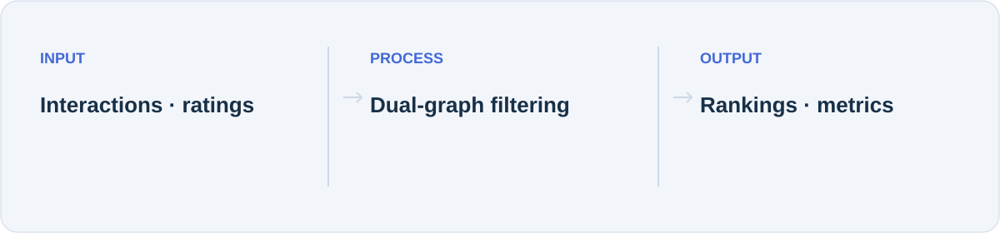
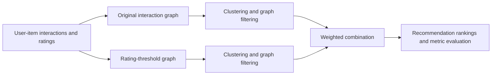

<a name="사용자-평점-기반-그래프-추천"></a>
<a name="사용자-평점-기반-그래프-필터링-추천"></a>
<a name="performance-improvement-of-recommendation-systems-using-user-evaluation-information"></a>

<a id="-rating-aware-recommendation-project"></a>

<!-- readme-header32:start -->
<a name="rating-aware-recommendation-project"></a>
<p align="center"></p>
<h1 align="center" id="project-title">Rating Aware Recommendation Project</h1>
<p align="center">Recommendation research using interactions and ratings</p>
<p align="center">
  <a href="../README.md"></a>
  <a href="README.md"></a>
</p>
<p align="center">
  <a href="../docs/%EC%9D%BD%EA%B8%B0%EC%95%88%EB%82%B4/%EB%A0%88%EB%B2%A81.md"></a>
  <a href="../docs/%EC%9D%BD%EA%B8%B0%EC%95%88%EB%82%B4/%EB%A0%88%EB%B2%A82.md"></a>
  <a href="../docs/%EC%9D%BD%EA%B8%B0%EC%95%88%EB%82%B4/%EB%A0%88%EB%B2%A83.md"></a>
  <a href="../docs/%EC%9D%BD%EA%B8%B0%EC%95%88%EB%82%B4/%EB%A0%88%EB%B2%A84.md"></a>
  <a href="../docs/%EC%9D%BD%EA%B8%B0%EC%95%88%EB%82%B4/%EB%A0%88%EB%B2%A85.md"></a>
</p>
<p align="center"><small>LEVEL links open the Korean source at the same reading level.</small></p>
<picture>
  <source media="(max-width: 600px) and (prefers-color-scheme: dark)" srcset="../assets/readme/flow-en-dark-mobile.svg" />
  <source media="(max-width: 600px)" srcset="../assets/readme/flow-en-light-mobile.svg" />
  <source media="(prefers-color-scheme: dark)" srcset="../assets/readme/flow-en-dark.svg" />
  <source media="(prefers-color-scheme: light)" srcset="../assets/readme/flow-en-light.svg" />
  
</picture>
<!-- readme-header32:end -->


This study produces recommendation rankings using graph filters that incorporate user ratings.

<!-- reading-levels17:start -->
| Reading level | What the guide covers |
| --- | --- |
| [LEVEL 1 - Beginner (Korean source)](../docs/%EC%9D%BD%EA%B8%B0%EC%95%88%EB%82%B4/%EB%A0%88%EB%B2%A81.md) | Unfamiliar terms and concrete examples from input to result |
| [LEVEL 2 - Explorer (Korean source)](../docs/%EC%9D%BD%EA%B8%B0%EC%95%88%EB%82%B4/%EB%A0%88%EB%B2%A82.md) | The relationships between key concepts and processing steps |
| [LEVEL 3 - Practitioner (Korean source)](../docs/%EC%9D%BD%EA%B8%B0%EC%95%88%EB%82%B4/%EB%A0%88%EB%B2%A83.md) | Experiment and usage procedures, and how to interpret results |
| [LEVEL 4 - Advanced (Korean source)](../docs/%EC%9D%BD%EA%B8%B0%EC%95%88%EB%82%B4/%EB%A0%88%EB%B2%A84.md) | Code structure, settings, design choices, and constraints |
| [LEVEL 5 - Expert (Korean source)](../docs/%EC%9D%BD%EA%B8%B0%EC%95%88%EB%82%B4/%EB%A0%88%EB%B2%A85.md) | Papers, protocols, denominators, leakage, and unverified scope |

**Read the published paper:** The paper by 김희찬·곽윤석·김남기 was published in 사물인터넷융복합논문지 12(5), pages 25–33, 2026.10.

Read the complete 9-page published version through the [official KCI page](https://www.kci.go.kr/kciportal/landing/article.kci?arti_id=ART003399306).

The cover gives DOI 10.20465/KIOTS.2026.12.5.025; KCI is the reading link.

**The HWP is the earlier submission manuscript.**

The published PDF is not attached to this repository.

File-structure diagrams, hashes, and page counts in earlier revisions describe those historical submission materials.
<!-- reading-levels17:end -->

Field: Recommender systems › Graph signal processing › Rating-aware dual graph filters

`Paper and research materials` `Document`

[Read the paper](#quick-start) · [Repository structure](#structure) · [Materials and settings](#data)

[Core components](#input-processing-output)

<details>
<summary>Paper title</summary>

Performance Improvement of Recommendation Systems using User Evaluation Information

</details>

<a id="-연구-핵심"></a>

## Research overview

The manuscript evaluates recommendation rankings by combining an interaction graph with rating information.

It describes the recommendation-graph construction and dataset-specific comparisons.

- The design combines two graphs and describes ratings/interactions in four datasets.
- It compares F1, NDCG, and MRR by K, including the decrease in ML-1M MRR @10.

**Materials:** [Final manuscript (Korean source)](../docs/versions/final-paper.md) · [Complete history (Korean source)](../docs/VERSIONS.md)

<a name="preview"></a>


[Open the source](https://www.kci.go.kr/kciportal/landing/article.kci?arti_id=ART003399306)

<a name="input-processing-output"></a>

<a id="-입력처리출력"></a>

## Input, processing, and output

| Component | Description |
| --- | --- |
| Problem | Compare how adding rating information to a graph affects recommendation rankings. |
| Input | User-item interactions and ratings |
| Processing | Combine two HiGSP-based graphs and their filter scores |
| Output | Recommendation rankings and NDCG/MRR metrics |

---

<a id="-논문과-최신-자료"></a>

## Paper and current materials

| Material | Original source |
| --- | --- |
| Final paper · Rating-aware recommendations | [Official publication page](https://www.kci.go.kr/kciportal/landing/article.kci?arti_id=ART003399306) |

[Material descriptions (Korean source)](../docs/PAPERS.md) · [Code revisions and change history (Korean source)](../docs/REVISION_INDEX.md)

<a id="️-차수별-프로젝트-안내"></a>

## All revisions

| Revision or stage | Main content | Materials and comparison with the previous version |
| --- | --- | --- |
| [Revision 1 · 06.17/06.22/06.29 manuscript set (Korean source)](../docs/revisions/paper-1.md) | The early editing stage covering the 06.17·06.22·06.29 revisions and an English manuscript. | [Folder](../%EC%9B%90%EA%B3%A0%EB%8B%A8%EA%B3%84/1%EC%B0%A8)<br>[Full comparison (Korean source)](../docs/revision-diffs/paper-1-%EC%97%B4%EB%9E%8C.md) |
| [Revision 2 manuscript (Korean source)](../docs/revisions/paper-2.md) | <a id="layout18-table-4-row-2-field-1"></a>This stage organizes evaluation around four datasets and clarifies rating thresholds, combination ratios, and metric exceptions. | [Folder](../%EB%85%BC%EB%AC%B8)<br>[Full comparison (Korean source)](../docs/revision-diffs/paper-2-%EC%97%B4%EB%9E%8C.md) |
| [Revision 3 · Institute-of-Internet-of-Things format (Korean source)](../docs/revisions/paper-3.md) | An editing stage for Korean/English abstracts, titles, and formatting; distinguish the different reference-list versions of the same study. | [Folder](../%EB%85%BC%EB%AC%B8)<br>[Full comparison (Korean source)](../docs/revision-diffs/paper-3-%EC%97%B4%EB%9E%8C.md) |
| [Final manuscript (Korean source)](../docs/revisions/final.md) | <a id="layout18-table-4-row-4-field-1"></a>This stage describes the then-current 10-page submission manuscript comparing recommendation rankings by combining user ratings with the original interaction graph.<br>The current 9-page published version is on the official KCI page. | [Folder](../%EB%85%BC%EB%AC%B8)<br>[Full comparison (Korean source)](../docs/revision-diffs/final-%EC%97%B4%EB%9E%8C.md) |


<a id="-프로젝트-소개"></a>

## Research method

Authors: **김희찬 · 곽윤석 · 김남기** (names as credited in the paper)

The research manuscript was prepared in the **사물인터넷융복합논문지** format of 한국사물인터넷학회.

| Component | What the manuscript covers |
| --- | --- |
| Two graphs | Distinguish the complete interaction graph from graphs retaining ratings of at least 2 or 5. |
| Graph filtering | Apply user clustering and ideal/high-order low-pass filters. |
| Weighted combination | Combine predictions from the original HiGSP workflow and the rating-based workflow. |
| Recommendation metrics | Compare F1, MRR, and NDCG across four datasets at K =5·10. |



<a name="structure"></a>
<a id="-저장소-구성"></a>

## Repository structure

```text
.
├── README.md
├── CHANGELOG.md
└── 논문/
    └── 최종_논문.pdf
```

- [Complete final paper](https://www.kci.go.kr/kciportal/landing/article.kci?arti_id=ART003399306)

<a id="-평점-정보와-가중-결합"></a>

## Rating information and weighted combination

The comparison uses ML-100K, ML-Latest-Small, ML-1M, and CiaoDVD. A rating threshold selects interactions retained in the additional graph. The original graph is used alongside it to reduce information loss from discarding all low-rating interactions.

The default combination ratio is 5:5. Ratings5 makes exceptions of 7:3 for ML-Latest-Small and 8:2 for ML-1M. Comparisons between the two settings reflect both the rating threshold and graph-combination ratio.

Experiment settings are alpha1 0.3, alpha2 0.7, filter order 8, 256 singular components, 5 clusters, and random_state 2024. The manuscript's environment table records the environment and package versions used at that time.

<a name="quick-start"></a>
<a id="-원고-읽기"></a>

## Reading the paper

1. Open the final paper linked above.
2. Start with the research question and method in the introduction.
3. Read the results tables together with limitations and future work.

The research paper describes a recommendation method combining user ratings and interaction graphs, with comparisons for each dataset.

<a name="data"></a>
<a id="-자료-구성과-결과-해석"></a>

## Materials and interpretation

The current published version is linked through the official KCI page; earlier editable originals are preserved as submission manuscripts. Changes in Revisions 1~3 remain in descriptions and comparison history.

Actual recommendation-service user records and original datasets are not uploaded. The current final original preserves author names, official affiliations, emails, author-profile photos, research text, and figures. Earlier public versions are available through Git history.

<a name="원고가-보고한-결과와-한계"></a>

<a id="-원고가-보고한-결과와-한계"></a>

### Reported results and limitations

The manuscript reports improvements for Ratings2 in 23 of 24 dataset/metric combinations; ML-1M MRR @10 decreases from 0.5603 to 0.5601. Ratings5 reportedly improves all 24 combinations.

CiaoDVD MRR @5 increases from 0.0133 →0.0155, a relative improvement of 16.54%.

For CiaoDVD, Ratings5 exceeds Ratings2 on all three metrics at K =5, whereas Ratings2 is higher at K =10. Suitable thresholds depend on both dataset and evaluation K.

| Dataset | Users | Items | Interactions | Rating range |
| --- | --- | --- | --- | --- |
| ML-100K | 943 | 1,682 | 100K | 1~5 |
| ML-Latest-Small | 610 | 9,724 | 100K | 0.5~5.0 |
| ML-1M | 6,040 | 3,706 | 1M | 1~5 |
| CiaoDVD | 17,615 | 16,121 | 72K | 1~5 |

These sizes follow the table on page 5 of the manuscript. It describes resplitting ML-100K/ML-1M training and test data but provides no public execution code or split lists.

F1 combines recommendation-list precision and recall; MRR assesses the rank of a correct item; NDCG evaluates relevance by rank. Read all results separately at K =5·10.

Runtime/memory measurements, additional-graph processing cost, and statistical-significance testing remain future work. The influence of graph weights also needs evaluation.

<a id="-문제-해결"></a>

## Questions and checks

| Situation | What to check |
| --- | --- |
| You want to reproduce recommendations immediately. | These are paper-centered materials.<br>An executable code/environment package is not guaranteed. |
| Did every metric improve? | Check condition-specific results, including the Ratings2 decrease in ML-1M MRR @10. |
| A relative improvement looks large. | Relative percentages can be large when the baseline score is low; also inspect absolute score differences. |

The current final paper is on the [official publication page](https://www.kci.go.kr/kciportal/landing/article.kci?arti_id=ART003399306). Earlier drafts belong to their own revision records.

<a id="-현재-첨부-문서"></a>

## Current documents and change history

These are the current originals and their comparison with the previous public version. Earlier manuscripts, presentations, and code can be found in the all-revisions table.

| Document | Material folder | Details and full comparison with the previous public version |
| --- | --- | --- |
| Final paper · Rating-aware recommendations | [Folder](../%EB%85%BC%EB%AC%B8) | [Description (Korean source)](../docs/latest/rating-aware-graph-filter.md)<br>[Full comparison (Korean source)](../docs/changes/2026-11-02-%EC%B5%9C%EC%8B%A0%EB%AC%B8%EC%84%9C-%EC%A0%84%EC%B2%B4%EB%B9%84%EA%B5%90.md) |

[Changes to the current document structure (Korean source)](../docs/changes/2026-11-02-%EC%B5%9C%EC%8B%A0%EB%AC%B8%EC%84%9C.md)

<a name="research-details"></a>

<a id="-연구구현의-세부-흐름"></a>

## Methods and conditions by revision

Inputs, processing methods, execution conditions, and results are organized by revision.

<a id="-1차--평점-기반-추천-원고의-수정-흐름"></a>

<details>
<summary>Revision 1 · Editing the rating-aware recommendation manuscript</summary>

<a id="1차평점-기반-추천-원고의-수정-흐름"></a>

The early editing stage covering the 06.17·06.22·06.29 revisions and an English manuscript.

| Component | Content |
| --- | --- |
| <a id="layout18-table-9-row-1"></a> Initial claims | Distinguish historical inconsistencies, including “five benchmark datasets” in the English abstract versus four datasets in the body table. |
| <a id="layout18-table-9-row-2"></a> Editing changes | Compare how Korean/English wording and graph-filter descriptions change between stages. |
| <a id="layout18-table-9-row-3"></a> Rating graphs | Construct Ratings2/Ratings5 using rating information at thresholds of at least 2/5. |
| <a id="layout18-table-9-row-4"></a> Dual workflows | Combine the original complete-interaction workflow with the rating-information workflow. |
| <a id="layout18-table-9-row-5"></a> Evaluation metrics | Read F1, MRR, and NDCG separately for K5·10 and each dataset. |
| <a id="layout18-table-9-row-6"></a> Default combination | Check the default 5:5 ratio and dataset-specific Ratings5 exceptions against the tables. |


| Input or condition | Description |
| --- | --- |
| Datasets | ML-100K·ML-Latest-Small·ML-1M·CiaoDVD |
| Rating threshold | 2 or 5 |
| Evaluation | F1·MRR·NDCG, K5·10 |
| Default weight | HiGSP:proposed workflow 5:5·some Ratings5 exceptions |

The final manuscript reports improvement over HiGSP in 23 of 24 Ratings2 combinations and all 24 Ratings5 combinations. Read these as manuscript-reported results for each dataset, metric, and rating threshold.

Effects differ by default combination ratio, rating threshold, dataset, and metric. They do not establish equally improved recommendation quality for every user or results from a deployed service.

| Constraint | What to check |
| --- | --- |
| Material scope | Manuscripts and figures; the recommendation service, experiment code, and original user logs are separate materials. |
| Improvement exception | Ratings2 decreases ML-1M MRR @10.<br>Do not generalize that all metrics improve. |
| Bibliography | Distinguish volume/issue/date placeholders from official publication confirmation. |

[Files, key definitions, and reading order (Korean source)](../docs/revisions/paper-1.md) · [Full comparison for this stage (Korean source)](../docs/revision-diffs/paper-1-%EC%97%B4%EB%9E%8C.md)

<a id="-2차--평점-임계값과-지표-해석-구체화"></a>

</details>

<details>
<summary>Revision 2 · Clarifying rating thresholds and metric interpretation</summary>

### Revision 2 · Clarifying rating thresholds and metric interpretation

This stage organizes evaluation around four datasets and clarifies rating thresholds, combination ratios, and metric exceptions.

| Component | Content |
| --- | --- |
| Explicit conditions | Specify the Ratings2/Ratings5 thresholds of 2/5 and the default 5:5 combination ratio. |
| Explicit exceptions | Clarify the ML-1M MRR @10 decrease and the high-order-filter description. |
| Rating graphs | Construct Ratings2/Ratings5 using rating information at thresholds of at least 2/5. |
| Dual workflows | Combine the original complete-interaction workflow with the rating-information workflow. |
| Evaluation metrics | Read F1, MRR, and NDCG separately for K5·10 and each dataset. |
| Default combination | Check the default 5:5 ratio and dataset-specific Ratings5 exceptions against the tables. |

| Input or condition | Description |
| --- | --- |
| Datasets | ML-100K·ML-Latest-Small·ML-1M·CiaoDVD |
| Rating threshold | 2 or 5 |
| Evaluation | F1·MRR·NDCG, K5·10 |
| Default weight | HiGSP:proposed workflow 5:5·some Ratings5 exceptions |

The final manuscript reports improvement over HiGSP in 23 of 24 Ratings2 combinations and all 24 Ratings5 combinations. Read these as manuscript-reported results for each dataset, metric, and rating threshold.

Effects differ by default combination ratio, rating threshold, dataset, and metric. They do not establish equally improved recommendation quality for every user or results from a deployed service.

| Constraint | What to check |
| --- | --- |
| Material scope | Manuscripts and figures; the recommendation service, experiment code, and original user logs are separate materials. |
| Improvement exception | Ratings2 decreases ML-1M MRR @10.<br>Do not generalize that all metrics improve. |
| Bibliography | Distinguish volume/issue/date placeholders from official publication confirmation. |

[Files, key definitions, and reading order (Korean source)](../docs/revisions/paper-2.md) · [Full comparison for this stage (Korean source)](../docs/revision-diffs/paper-2-%EC%97%B4%EB%9E%8C.md)

<a id="-3차--사물인터넷학회-양식과-참고문헌-편집"></a>

</details>

<details>
<summary>Revision 3 · Journal formatting and reference editing</summary>

<a id="3차사물-인터넷-학회-양식과-참고-문헌-편집"></a>

An editing stage for Korean/English abstracts, titles, and formatting; distinguish the different reference-list versions of the same study.

| Component | Content |
| --- | --- |
| <a id="layout18-table-15-row-1"></a> Formatting | Review the title, Korean/English abstracts, and manuscript structure in 한국사물인터넷학회 format. |
| <a id="layout18-table-15-row-2"></a> Version identity | 12.hwp differs from the final manuscript in its reference editing.<br>Do not force it to match a similarly named PDF. |
| <a id="layout18-table-15-row-3"></a> Rating graphs | Construct Ratings2/Ratings5 using rating information at thresholds of at least 2/5. |
| <a id="layout18-table-15-row-4"></a> Dual workflows | Combine the original complete-interaction workflow with the rating-information workflow. |
| <a id="layout18-table-15-row-5"></a> Evaluation metrics | Read F1, MRR, and NDCG separately for K5·10 and each dataset. |
| <a id="layout18-table-15-row-6"></a> Default combination | Check the default 5:5 ratio and dataset-specific Ratings5 exceptions against the tables. |


| Input or condition | Description |
| --- | --- |
| Datasets | ML-100K·ML-Latest-Small·ML-1M·CiaoDVD |
| Rating threshold | 2 or 5 |
| Evaluation | F1·MRR·NDCG, K5·10 |
| Default weight | HiGSP:proposed workflow 5:5·some Ratings5 exceptions |

The final manuscript reports improvement over HiGSP in 23 of 24 Ratings2 combinations and all 24 Ratings5 combinations. Read these as manuscript-reported results for each dataset, metric, and rating threshold.

Effects differ by default combination ratio, rating threshold, dataset, and metric. They do not establish equally improved recommendation quality for every user or results from a deployed service.

| Constraint | What to check |
| --- | --- |
| Material scope | Manuscripts and figures; the recommendation service, experiment code, and original user logs are separate materials. |
| Improvement exception | Ratings2 decreases ML-1M MRR @10.<br>Do not generalize that all metrics improve. |
| Bibliography | Distinguish volume/issue/date placeholders from official publication confirmation. |

[Files, key definitions, and reading order (Korean source)](../docs/revisions/paper-3.md) · [Full comparison for this stage (Korean source)](../docs/revision-diffs/paper-3-%EC%97%B4%EB%9E%8C.md)

<a id="-최종-원고--사용자-평점을-활용한-추천-성능-비교"></a>

</details>

<details>
<summary>Final manuscript · Comparing recommendation performance using user ratings</summary>

<a id="최종-원고--사용자-평점을-활용한-추천-성능-비교"></a>

This stage describes the then-current 10-page submission manuscript comparing recommendation rankings by combining user ratings with the original interaction graph. The current 9-page published version is on the official KCI page.

| Component | Content |
| --- | --- |
| <a id="layout18-table-18-row-1"></a> Complete final text | Link to the current published version on its official page; retain the earlier HWP, including photos, as a submission manuscript. |
| <a id="layout18-table-18-row-2"></a> Reported results | Of 24 combinations from four datasets × two K values × three metrics, Ratings2 reportedly improves 23 and Ratings5 improves 24. |
| <a id="layout18-table-18-row-3"></a> Rating graphs | Construct Ratings2/Ratings5 using rating information at thresholds of at least 2/5. |
| <a id="layout18-table-18-row-4"></a> Dual workflows | Combine the original complete-interaction workflow with the rating-information workflow. |
| <a id="layout18-table-18-row-5"></a> Evaluation metrics | Read F1, MRR, and NDCG separately for K5·10 and each dataset. |
| <a id="layout18-table-18-row-6"></a> Default combination | Check the default 5:5 ratio and dataset-specific Ratings5 exceptions against the tables. |


| Input or condition | Description |
| --- | --- |
| Datasets | ML-100K·ML-Latest-Small·ML-1M·CiaoDVD |
| Rating threshold | 2 or 5 |
| Evaluation | F1·MRR·NDCG, K5·10 |
| Default weight | HiGSP:proposed workflow 5:5·some Ratings5 exceptions |

The final manuscript reports improvement over HiGSP in 23 of 24 Ratings2 combinations and all 24 Ratings5 combinations. Read these as manuscript-reported results for each dataset, metric, and rating threshold.

Effects differ by default combination ratio, rating threshold, dataset, and metric. They do not establish equally improved recommendation quality for every user or results from a deployed service.

| Constraint | What to check |
| --- | --- |
| Material scope | Manuscripts and figures; the recommendation service, experiment code, and original user logs are separate materials. |
| Improvement exception | Ratings2 decreases ML-1M MRR @10.<br>Do not generalize that all metrics improve. |
| Bibliography | Distinguish volume/issue/date placeholders from official publication confirmation. |

[Files, key definitions, and reading order (Korean source)](../docs/revisions/final.md) · [Full comparison for this stage (Korean source)](../docs/revision-diffs/final-%EC%97%B4%EB%9E%8C.md)

[Changes to the revision guides (Korean source)](../docs/changes/2026-11-03-%EC%B0%A8%EC%88%98%EB%B3%84%ED%94%84%EB%A1%9C%EC%A0%9D%ED%8A%B8%EC%95%88%EB%82%B4.md)

</details>
